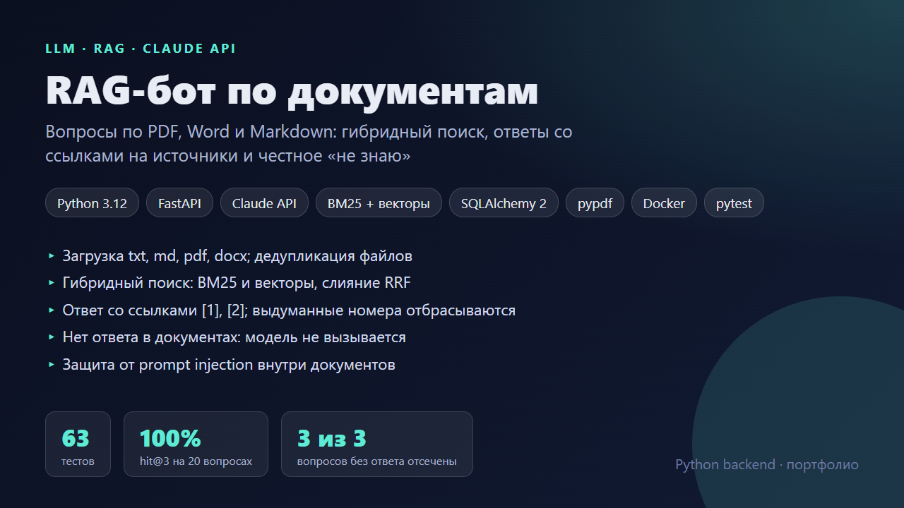
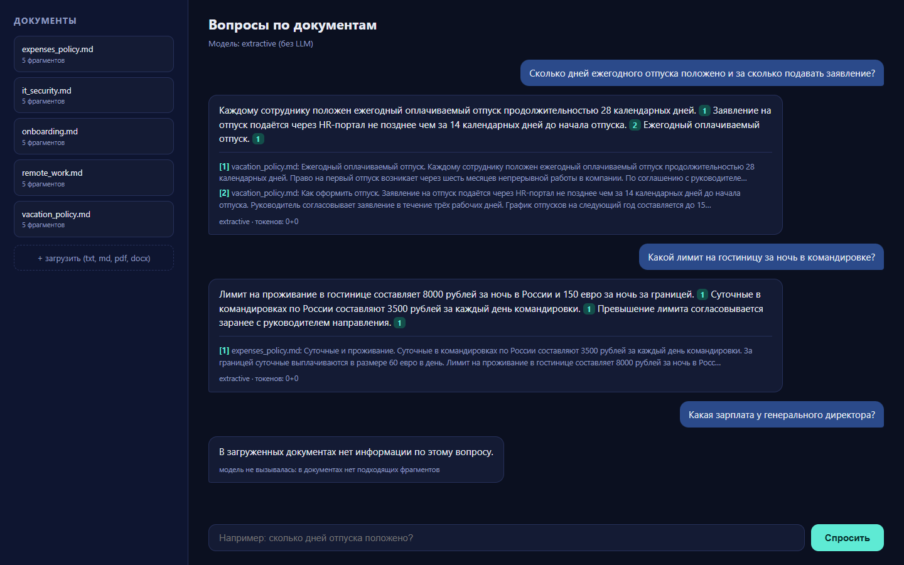
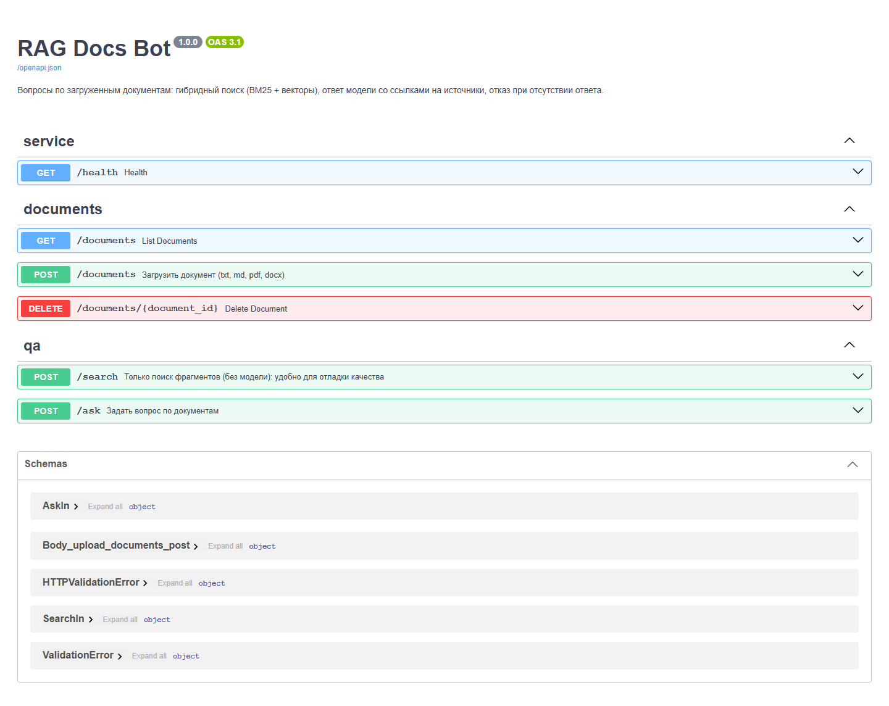
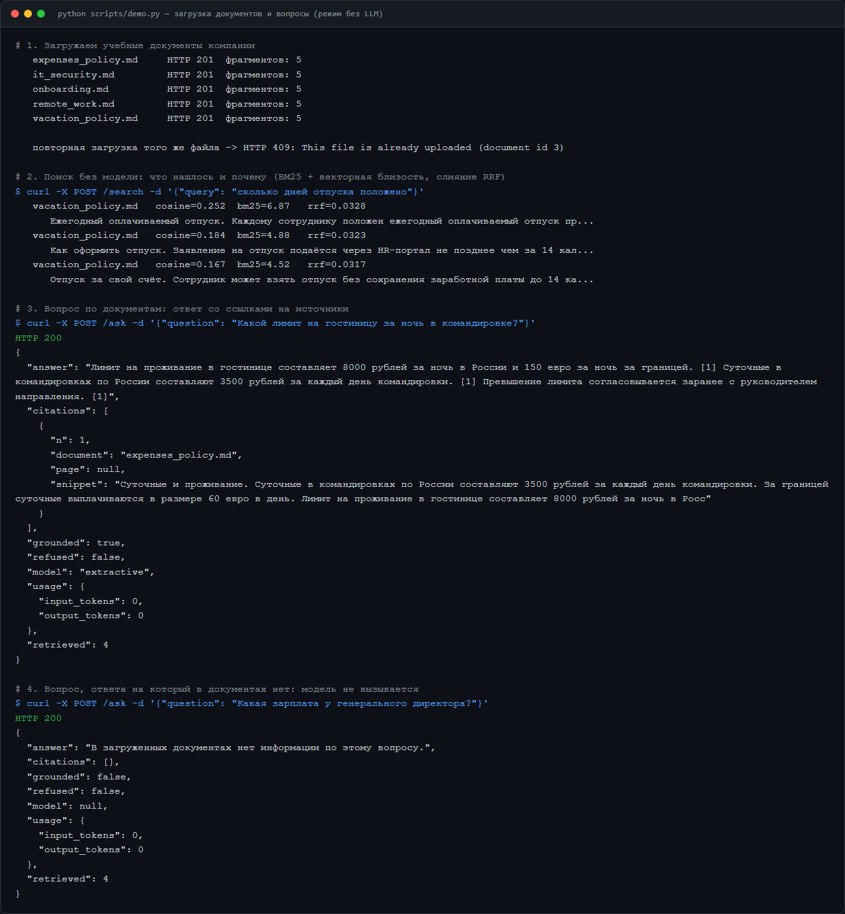
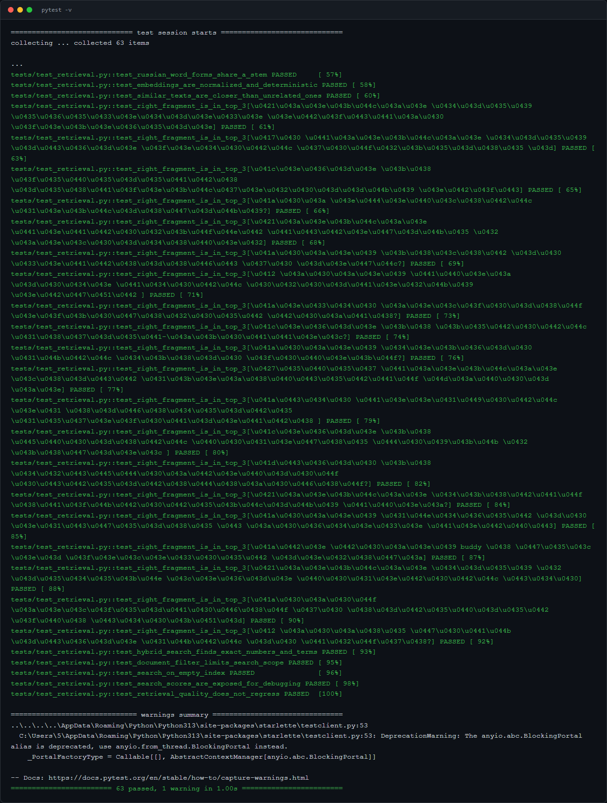

# RAG-бот по документам

Загружаете PDF, Word или Markdown и задаёте вопросы на обычном языке. Сервис находит подходящие фрагменты, передаёт их модели Claude и возвращает ответ со ссылками на источники. Если ответа в документах нет, он говорит об этом и не вызывает модель.





> На скриншотах сервис работает в **режиме без LLM** (`LLM_PROVIDER=extractive`): ключа API в среде подготовки не было, поэтому ответ собирается из найденных предложений. Поиск, ссылки, пороги и API идентичны. С ключом Anthropic ответ формулирует Claude.

## Как это работает

```
файл ─> текст ─> фрагменты (по заголовкам, ~800 символов, перекрытие) ─> вектор + индекс слов ─> БД
вопрос ─> BM25 + векторная близость ─> слияние RRF ─> top-k фрагментов
        ─> достаточно релевантны? нет ─> «в документах нет ответа» (модель не вызывается)
        ─> да ─> промпт с <source id="n"> ─> Claude ─> проверка ссылок [n] ─> ответ + источники
```

| Задача | Решение |
|---|---|
| Поиск по точным терминам и числам («60 000», «security@») плюс по смыслу | **Гибридный поиск**: BM25 и векторы, ранги сливаются методом RRF |
| Русская морфология («отпуск, отпуска, отпуском») | Нормализация словоформ усечением основы, один и тот же корень в запросе и документах |
| Модель выдумывает ответ, когда его нет в документах | Порог релевантности: ниже порога **модель не вызывается** (нет галлюцинации и расхода токенов). Системный промпт требует отвечать только по источникам |
| Модель ссылается на несуществующий источник | Номера `[n]` проверяются: выдуманные удаляются, ответ без единой валидной ссылки помечается `grounded: false` |
| Prompt injection («игнорируй инструкции») внутри документа | Тексты документов лежат в тегах `<source>` и описаны как данные, а не инструкции. Тест проверяет, что чужой текст не попадает в системный промпт |
| Один файл загружен дважды | Дедупликация по SHA-256 (`409`) |
| Отказ модели по политике безопасности | `stop_reason: "refusal"` обрабатывается явно (`refused: true`). Включён server-side fallback на запасную модель |
| Сбои API модели | Ошибки SDK сопоставлены со статусами: `503` (можно повторить), `502` (нельзя) |

## Работа с Claude API

`app/llm.py`: адаптер на официальном SDK `anthropic`. Остальной код зависит только от метода `complete()`, поэтому другого провайдера (например, OpenAI) можно подключить отдельным классом.

- Модель по умолчанию `claude-opus-5-5`, глубина рассуждения через `output_config.effort` (по умолчанию `low` для коротких ответов в чате).
- Не передаются `temperature`, `top_p`, `budget_tokens`: эта модель их отклоняет, а рассуждение у неё включено всегда.
- Запасная модель на случай отказа настраивается `LLM_FALLBACK_MODEL`, отключается `LLM_REFUSAL_FALLBACK=0`.
- Ключ берётся из `ANTHROPIC_API_KEY` или из профиля `ant auth login` (тогда задайте `LLM_PROVIDER=anthropic`).

## Качество поиска (измерено)

`python -m eval.run_eval` прогоняет 20 вопросов с известным ответом и 3 вопроса без ответа в документах:

| Метрика | Значение |
|---|---|
| hit@1 / hit@3 (нужный документ в топе) | 95% / 100% |
| hit@3 с ответом (в топ-3 есть фрагмент с ожидаемой фразой) | 100% |
| MRR | 0,975 |
| Вопросы без ответа, корректно отсечённые порогом | 3 из 3 |

**Оговорки:** набор небольшой, составлен автором под эти же пять документов, и порог релевантности подбирался на нём. Это проверка на регрессии, а не независимая оценка. На своих документах соберите свой набор вопросов (`eval/qa.jsonl`) и прогоните то же самое. Эмбеддинги по умолчанию лексические (хэширование признаков): они не понимают синонимов. Для настоящей семантики реализуйте интерфейс `Embedder` поверх API эмбеддингов и храните векторы в pgvector.

Ответы **самой модели** в этих тестах не проверялись: вызовы Claude покрыты тестами на фейковом клиенте (какой именно запрос уходит в SDK, как разбирается ответ и ошибки), живой вызов API в подготовке не выполнялся.

## Запуск

```bash
pip install -r requirements.txt
uvicorn app.main:app --reload          # http://localhost:8000 (чат) и /docs
python scripts/demo.py                 # загрузка учебных документов и вопросы
pytest                                 # 63 теста
```

С моделью:

```bash
export ANTHROPIC_API_KEY=sk-ant-...
LLM_PROVIDER=auto uvicorn app.main:app
```

```bash
docker compose up --build              # PostgreSQL + API
```

## Скриншоты

| Swagger | Демо-сценарий | Тесты |
|---|---|---|
|  |  |  |
